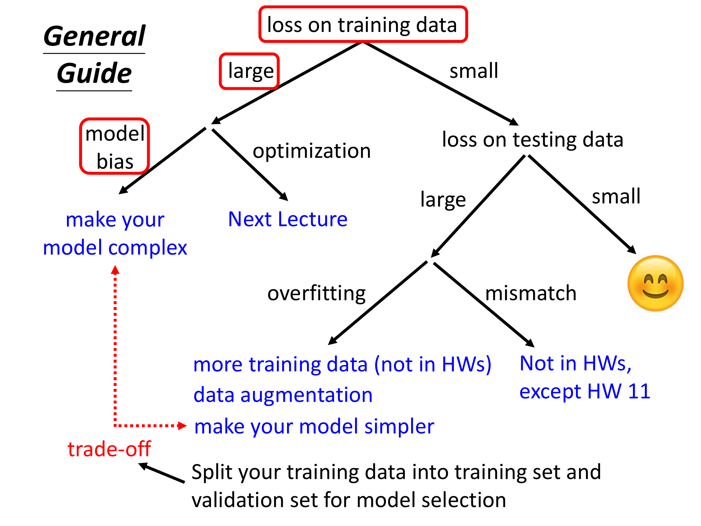

# 模型训练心得：一张决策树的用法

> 记录日期：**2026-11-15**
> 来源：课上「General Guide」那张流程图 + HW01 / HW02 的实测经验
> 配套：[AGENT.md](../AGENT.md)（怎么和 AI 配合）· 本文是「怎么判断模型出了什么问题」

---

## 0. 这张图在讲什么



*图源：李宏毅《機器學習》2021 Spring 課程講義（HW 说明用图），版权属原作者，此处仅作个人学习笔记引用。*

整张图只做一件事：**把「模型效果不好」这个大问题，拆成三个能分别回答的是非题**。

```
loss on training data
├── large ──┬── model bias      → make your model complex（加宽 / 加深 / 加特征）
│           └── optimization    → 换优化器 / 调 lr / 加 BN / 查梯度
└── small
    └── loss on testing data
        ├── large ──┬── overfitting → 更多数据 / 数据增强 / 简化模型
        │           └── mismatch    → 训练分布 ≠ 测试分布
        └── small   → 完成
```

左下角那根红色虚线 `trade-off` 是整张图的灵魂：**「加复杂度」和「简化模型」是同一根绳子的两头**。你为了解决 bias 去加容量，就会把风险推到 overfitting 那一侧；反过来也一样。所以不存在「一路加宽到底」的解法，只存在「在两头之间找一个当前最优点」。

还有一个容易被忽略的细节：图最底下写着 **「Split your training data into training set and validation set for model selection」**。这句话不是附注，而是**整张图能成立的前提**——如果没有一个可信的验证集，你根本没法判断自己站在哪个分支上。

---

## 1. 每一支怎么判断（实操版）

### 1.1 第一步：训练损失是大还是小

「大/小」不是一个绝对数，要跟**基线**比：

| 任务类型 | 判断方式 |
|---|---|
| 分类 | 训练 accuracy 与「人类/基线水平」的差距 |
| 回归 | 训练 loss 相对目标值标准差的比值 |
| 参考 | 训练集上如果连「接近 0 损失」都做不到，一定是 large |

### 1.2 第二步（关键）：是 model bias 还是 optimization

课上把 optimization 留到下一讲，但实操里有个**五分钟就能做完的判别法**：

> **拿一小批数据（比如 500 条）让同一个模型过拟合。**
> - 能把训练损失压到接近 0 → 优化链路没问题，**是 model bias**，去加复杂度
> - 压不下去 → **是 optimization 问题**，先别动模型结构，去查 lr / 初始化 / 归一化 / 梯度

HW02 里我们其实无意中做过这个测试的**反向版本**：v5 那版把训练集刷到了 **train 0.997**。这直接证明了「优化链路是通的、模型容量也够」——所以 v5 的问题**不可能**是 bias 或 optimization，只可能是 overfitting。这一个数字就排除掉了两条分支。

### 1.3 第三步：过拟合还是 mismatch

两者表现都是「训练好、测试差」，但处理方式完全相反：

| | overfitting | mismatch |
|---|---|---|
| 本质 | 模型记住了训练集的噪声 | 训练分布和测试分布根本不是同一个 |
| 证据 | 训练/验证 gap 大，且 gap 随容量增长 | 验证集很好，但一提交就崩；或训练与测试的特征分布有系统性偏移 |
| 处理 | 加数据 / 增强 / 简化模型 / 正则 | 改数据构造、改切分、做域适应（HW11 的内容） |
| 能否用「加数据」解决 | 能 | 不能——加的是错分布的数据 |

判别方法：**直接比较训练集和测试集的特征分布**（均值、方差、分位数）。HW02 我们做过这个检查：

| 检查项 | 结果 | 结论 |
|---|---|---|
| 前 80% / 后 20% 标签分布 | TV 距离 0.0195，KL 0.0013 | 无偏移 |
| 特征均值漂移（val vs train） | 平均 0.010σ，最大 0.035σ | 无偏移 |
| 特征均值漂移（test vs train） | 平均 0.008σ，最大 0.033σ | 无偏移 |

三条都接近 0 → **mismatch 这条分支被排除**，问题只在 overfitting。这就是「用证据砍掉分支」的典型用法，而不是靠感觉。

---

## 2. 把 HW01 / HW02 挂到树上看

### HW02（音素分类）

| 观察 | 判定 | 采取的动作 | 结果 |
|---|---|---|---|
| 官方 baseline：train 0.791 / val 0.704 | testing loss 偏大，走 overfitting 分支 | 加正则（ReLU+BN+Dropout）、加窗口 | 0.68917 → 0.73203 |
| 继续加容量到 12.8 M：train 0.997 / val 0.745 | 训练损失变小、测试更差 → **走错分支**（走了 bias 分支） | 应该「简化模型」 | 反而退步（0.7448 < 0.7495） |
| 把 80% 数据换成 100% | overfitting 分支的标准动作 | 加数据 | 0.73203 → 0.74719（+1.5） |
| 验证集可信、无漂移 | 确认不是 mismatch | 不用做域适应 | 节省一整轮实验 |
| 单模型到顶 | — | 集成（不属于树上的任何分支，是「同一分布下的方差 reduction」） | 0.74719 → 0.75869 |

**教训**：v4（CNN）和 v5（12.8 M 残差）都是**在看到「testing loss 大」之后，反而去加复杂度**——正好走了反方向。根因是没先做 §1.2 那个小样本过拟合测试，直接凭「更深的网络更强」的直觉动手。

### HW01（回归）

| 观察 | 判定 | 纠正 |
|---|---|---|
| 按官方 `i % 10 == 0` 切验证集，RMSE 低到 0.1 | **测量工具坏了**（验证集泄漏），不是模型问题 | 改成「每个州最后 20% 天数」做验证 |
| 固定训 6000 epoch，LB 0.94 | overfitting（训练太久） | 按平台早停，约 700–1500 epoch |
| 训练 loss 停在 0.98 下不去 | 一开始误判为 model bias，实际是 optimization（早停点不对 + 学习率） | 调优化，不加容量 |
| CV 很好但 LB 差 0.02 | mismatch（测试集是「未来」，CV 是「过去的同分布」） | CV 只用于相对比较，不估绝对 LB |

**教训**：树上的三个分支之外，还有一个**第 0 分支：测量本身是否可信**。HW01 的 target 列名陷阱、HW02 的随机切分风险，都属于这一类。测量错了，后面所有判断都是错的。

---

## 3. 三张必做的检查表

### ① 过拟合测试（区分 bias / optimization）

```python
# 取 500 条样本，训练到几乎零损失
sub = train[:500]
# 能到 ~0 → optimization 没问题，问题在 bias 或 overfitting
# 到不了 → 先修优化，别动结构
```

### ② 验证集可信性检查（整张图的前提）

- 切分方式是否**模拟了测试集**？（HW01：测试集是未来 → 按时间切；HW02：相邻帧高度重叠 → 按顺序切，不能随机）
- 标签分布是否一致？（算 TV / KL）
- 特征分布是否一致？（算｜均值差｜/ 标准差）
- 有没有「同一条数据的近邻」跨在训练和验证两边？

### ③ 指标可信性检查

- 主指标 + 至少一个互补指标（RMSE vs R²、accuracy vs 小类 F1）
- 两个指标打架时，优先信分层指标
- val 与 public 的偏差要记录（HW02 稳定在 −0.017，可以当作校准常数）

---

## 4. 四种常见误判

| 误判 | 表现 | 后果 | 正确做法 |
|---|---|---|---|
| 把 optimization 当 bias | 训练损失下不去，就去加宽 | 参数翻倍、毫无改善 | 先做 500 样本过拟合测试 |
| 把 bias 当 overfitting | 训练损失本来就大，却去减容量/加 dropout | 越调越差 | 先看训练损失绝对值 |
| 把测量错误当模型问题 | 验证分数异常好或异常差 | 整轮实验方向错误 | 先查切分/列名/泄漏 |
| 拿 val 当 LB | 用 val 估绝对分数 | 对目标线的判断失准 | val 只用于相对比较，用历史偏差校准 |

---

## 5. 这条思维链的完整顺序

```
① 测量可信吗？        → 切分 / 列名 / 泄漏 / 指标定义
② 训练损失大吗？      → 大：做 500 样本过拟合测试
                         ├ 能过拟合 → model bias → 加复杂度（然后回到 ①）
                         └ 不能     → optimization → 调 lr / BN / 初始化
③ 测试损失大吗？      → 大：区分 overfitting / mismatch
                         ├ overfitting → 加数据 / 增强 / 简化模型
                         └ mismatch    → 改数据 / 域适应
④ 都小了吗？          → 是：收工；否：回到 ②
⑤ 单模型到顶          → 集成（方差 reduction，不是树上的分支，是额外一层）
```

每一步都只回答一个是非题，**不允许跳步**。跳步的代价在 HW02 上很具体：v4 花了 35 分钟 GPU 训练，v5 花了 40 分钟，两次都走在反方向，合起来浪费了一个多小时——而先做一次 500 样本测试只要 30 秒。

---

## 6. 一句话

> 这张图的价值不在于它列了多少方法，而在于它**强制你把「感觉不好」翻译成一个可以否证的问题**。
> 每次想动手改模型之前，先说出「我现在在哪一支、证据是什么」。说不出来，就是在猜。
